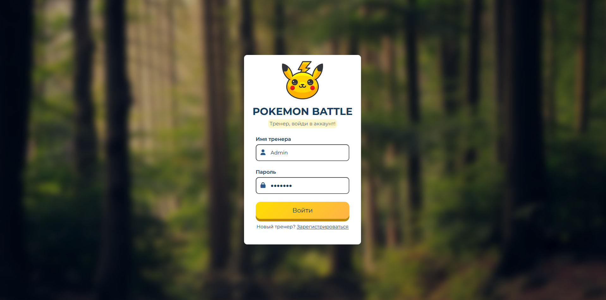
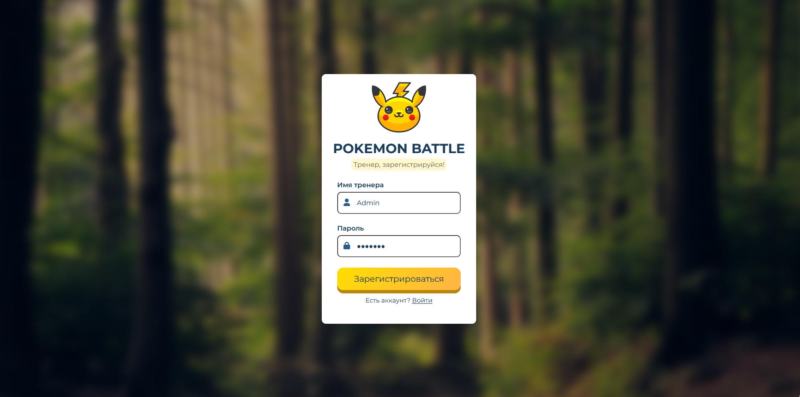
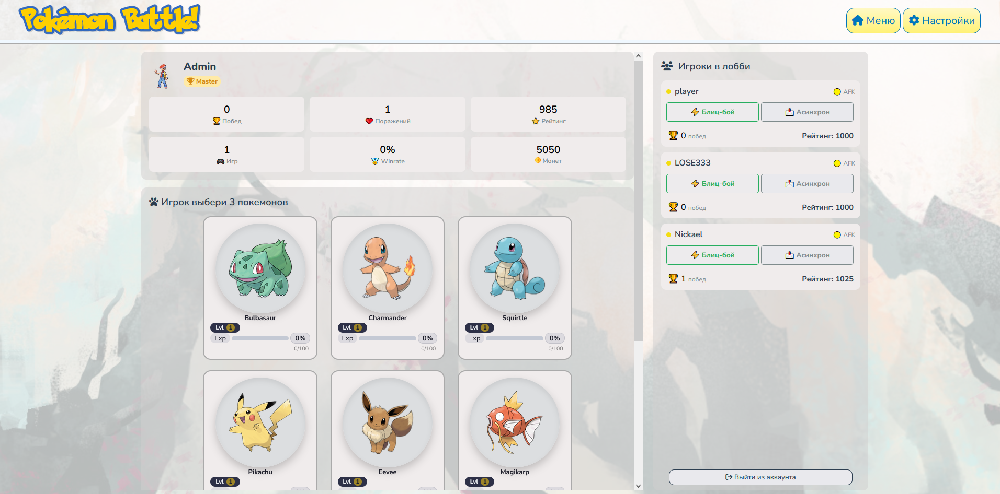
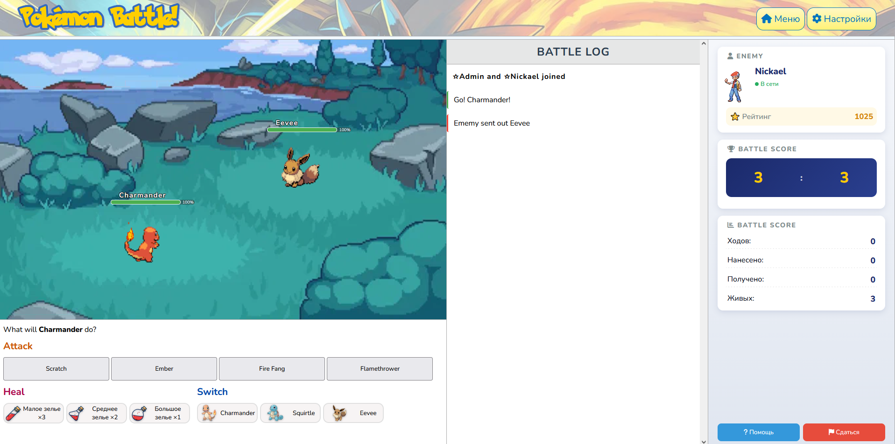

# Pokemon Battle 🎮

Веб-игра «Покемон-баттл» — пошаговая битва существ с прокачкой и коллекционированием.


## 📖 Описание

Игроки сражаются командами **3 на 3**. Победа даёт **опыт**, **монеты** и **рейтинг**. Существа **прокачиваются**, изучают новые атаки, а стихии влияют на урон.

Клиент — обычные HTML/CSS/JS без сборщика, сервер — Flask, вся игровая логика и состояние хранятся в SQLite.

## 📸 Скриншоты

| Вход | Регистрация |
|:---:|:---:|
|  |  |

| Меню и выбор противника | Бой |
|:---:|:---:|
|  |  |


## ✨ Возможности

- ✅ **6 базовых покемонов** с характеристиками (HP, атака, защита, скорость) и 4 атаками
- ✅ **Бой 1-на-1** с поочерёдными ходами (кто быстрее — ходит первым)
- ✅ **Стихии:** огонь > трава > вода > огонь (множители урона)
- ✅ **Бой 3 на 3** с возможностью смены существа
- ✅ **Прокачка** — опыт, уровни, рост характеристик
- ✅ **Инвентарь** — зелья лечения, использование в бою
- ✅ **Магазин** — покупка зелий за монеты
- ✅ **PvP и Async** — блиц-бой с реальным игроком или бой с ботом

## 🧠 Как устроен бой

1. Игрок выбирает противника в меню — создаётся игровая сессия.
2. Оба игрока собирают команду из трёх существ.
3. Ходы поочерёдные: атака, смена существа или использование зелья.
4. Урон считается по формуле `(атака + уровень) × сила атаки / (защита + уровень) / 5` с множителем стихии и случайным разбросом ±15 %.
5. Когда у одной из сторон не остаётся живых существ — бой завершается, начисляются опыт, монеты и рейтинг.

## 🛠 Технологии

| Слой | Чем реализовано |
|---|---|
| Backend | Python 3.10+, Flask, Flask-CORS |
| Хранилище | SQLite (`Backend/pokemon.db`) |
| Frontend | HTML5, CSS3, JavaScript (ES-модули), Font Awesome |
| Анимации | CSS keyframes + `requestAnimationFrame` |

## 🚀 Быстрый старт

### Требования

- **Python 3.10+**
- **pip**

### Установка

```bash
# 1. Клонировать репозиторий
git clone https://github.com/btauo/pokemon-battle.git
cd pokemon-battle

# 2. (опционально) виртуальное окружение
python -m venv venv
venv\Scripts\activate        # Windows
# source venv/bin/activate   # Linux / macOS

# 3. Установить зависимости
pip install flask flask-cors

# 4. Запуск
python Backend/app.py
```

Приложение поднимется на **http://localhost:5000** — откроется страница входа.

> Фронтенд обращается к API по адресу `http://localhost:5000`, поэтому порт менять не стоит.

## 📁 Структура проекта

```
pokemon-battle/
├── Backend/
│   ├── app.py                  # Flask: REST API и раздача статики
│   ├── database.py             # игровая логика и работа с SQLite
│   └── pokemon.db              # база: игроки, покемоны, бои, инвентарь
├── Frontend/
│   ├── LoginForm/              # вход и регистрация
│   │   └── login.html|js|css
│   ├── BattleForm/             # экран боя 3×3
│   │   └── pokemon.html|js|css # бой
│   ├── menu.html|js|css        # меню
│   ├── mainLobby/              # анимации атак, интерфейс боя
│   ├── image/                  # спрайты, фоны, иконки, гифки
│   ├── header.js               # общая шапка
│   └── main.css
└── docs/
    └── screenshots/            # скриншоты для этого README
```

## 🔌 API

| Метод | Эндпоинт | Назначение |
|---|---|---|
| `POST` | `/api/register`, `/api/login` | Регистрация и вход |
| `GET` | `/api/players` | Список игроков |
| `GET` | `/api/player/stats`, `/api/player/pokemons` | Профиль и коллекция |
| `POST` | `/api/player/status`, `/api/player/avatar` | Статус и аватар |
| `POST` | `/api/battle/create`, `/api/battle/async/start` | Создать PvP / бой с ботом |
| `POST` | `/api/battle/set_team` | Выбрать команду из трёх существ |
| `GET` | `/api/battle/info`, `/api/battle/check-turn`, `/api/battle/last-turn`, `/api/battle/damage` | Состояние боя |
| `POST` | `/api/battle/attack`, `/api/battle/switch-pokemon` | Атака и смена существа |
| `POST` | `/api/battle/use-potion`, `/api/battle/enemy-attack`, `/api/battle/enemy-switch` | Зелья и ходы бота |
| `POST` | `/api/battle/challenge`, `/api/battle/accept`, `/api/battle/cancel` | Вызов на бой (блиц) |
| `POST` | `/api/battle/end` | Завершение боя (в том числе сдача) |
| `GET` | `/api/inventory`, `/api/pokemonSkills` | Инвентарь и список атак |
| `POST` | `/api/shop/buy` | Покупка предметов |


